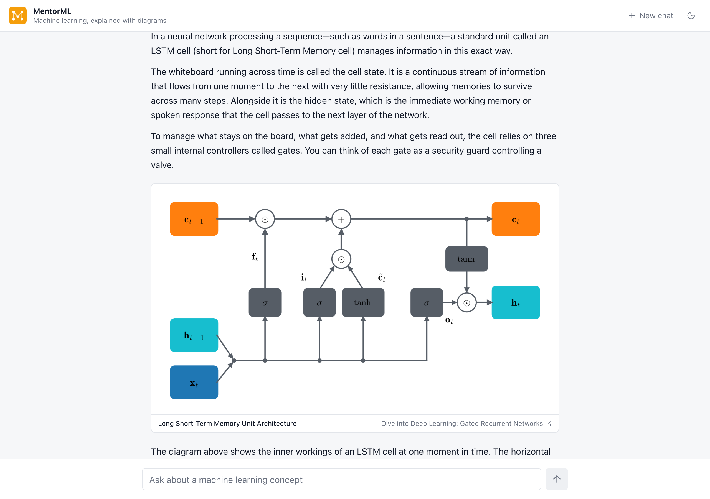
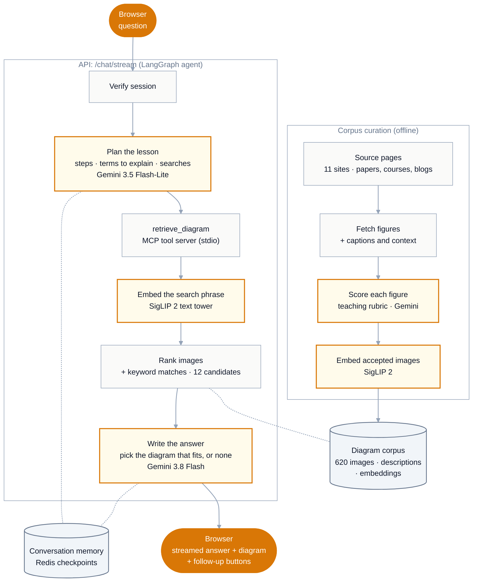

# MentorML

A teaching assistant for AI and machine learning that explains concepts in plain language with diagrams. A LangGraph agent plans a short lesson, retrieves candidate diagrams from a curated corpus with SigLIP 2, and writes an intuition-first explanation around the diagram that fits best.

<picture>
  <source media="(prefers-color-scheme: dark)" srcset="docs/screenshot-dark.png">
  
</picture>

## Features

- 🤖 **Plan-and-Execute Agent**: LangGraph agent with one structured planning call, tool-based retrieval and one streamed answer; the first words arrive in about 2.5 seconds
- 🔍 **SigLIP 2 Retrieval**: Query-image search over precomputed embeddings (82.6% top-1 against CLIP's 45.0% on the curated benchmark), plus keyword matches
- 🔌 **MCP Tool Server**: Diagram retrieval runs as a separate MCP subprocess (stdio); the agent calls it like any LangChain tool
- 🎨 **Curated Corpus**: 620 diagrams from 11 sources, each scored by a Gemini rubric for whether it teaches something, how much insight it adds, and how clear it is at a glance
- 💡 **Intuition First**: Answers open with an everyday analogy, explain every term in plain words before naming it, and leave formulas out unless you ask for the maths
- ↪️ **Follow-up Buttons**: Two or three suggested next questions under each answer, so going deeper is one click
- 🛟 **Model Fallbacks**: Gemini 3.8 Flash for answers and 3.5 Flash-Lite for planning, each with a fallback chain and time limits
- 📊 **LangSmith Eval**: Retrieval (SigLIP 2 vs CLIP) and end-to-end agent evals against a versioned dataset
- 💬 **Conversation Memory**: Redis-backed checkpoints with a 24-hour TTL
- 🌓 **Light and Dark Themes**: Follows the system setting, with a toggle in the header

## Architecture



**How a turn works.** The planner turns the question into a few teaching steps, a list of terms the answer must explain, up to two diagram searches and some follow-up questions, in one structured call. The searches go straight to the `retrieve_diagram` tool. Each returns about a dozen candidates with a description of what the image shows, written once when the corpus was curated, so no model looks at an image while the learner waits. The answer model then writes the explanation and cites the candidate that fits, or none: a missing diagram is better than an unrelated one. Only the last 8 exchanges are sent back to the model, so long conversations stay fast.

**How the corpus is built.** `scripts/curate_corpus.py` pulls figures from the source pages, and Gemini scores each one as a learner would see it: on its own, without the article around it. A figure is kept only if it teaches something, stands alone, and scores 4 or more out of 5 for insight, visual quality and being understandable at a glance. 620 of 2,308 candidates passed.

## Tech Stack

- **Frontend**: Vite 7, React 19, TypeScript, Tailwind CSS v4
- **Backend**: FastAPI, Python 3.11
- **Agent**: LangGraph (plan → retrieve → answer), Redis checkpointer, MCP tool server over stdio
- **AI/ML**:
  - Retrieval: SigLIP 2 So400m/14 @ 384px (PyTorch, Hugging Face `transformers`), 1152-dim embeddings; only the text tower runs at query time
  - Planning: Gemini 3.5 Flash-Lite, falling back to Gemini 3.6 Flash
  - Answers: Gemini 3.8 Flash, falling back to Gemini 3.6 Flash and then Gemini 3.5 Flash when a model errors, returns nothing or stalls
  - Curation rubric: Gemini 3 Flash
- **Evaluation**: LangSmith, with CLIP ViT-L/14 as the retrieval baseline

---

## Quick Start

### Prerequisites

- Python 3.10+
- Node.js 20.19+ or 22.12+ (required by Vite 7)
- Redis with the search module (Redis Stack), for conversation memory
- A Google AI Studio API key (for Gemini): https://aistudio.google.com/apikey
- About 5 GB of disk for the SigLIP 2 checkpoint

### 1. Clone & Install

```bash
git clone https://github.com/jessecui/mentor-ml.git
cd mentor-ml

python -m venv venv
source venv/bin/activate
pip install -r requirements.txt

cd frontend && npm install && cd ..
```

The diagram corpus (`corpus/`) is committed, so there is nothing to build before the first run.

### 2. Configure Environment

Copy `.env.example` to `.env` and fill it in:

```bash
GEMINI_API_KEY=your-google-ai-api-key   # Gemini (the older name GOOGLE_API_KEY also works)
CREATOR_NAME=your-name                  # the name the access prompt asks for
# Optional:
# AUTH_SECRET=...            # signs session cookies (derived from the two above if unset)
# ADMIN_TOKEN=...            # enables GET /misses (disabled if unset)
# REDIS_URL=redis://localhost:6379
# LANGSMITH_API_KEY=...      # tracing and evals
# LANGSMITH_TRACING=true
```

### 3. Start Redis

```bash
docker run -p 6379:6379 redis/redis-stack-server   # or: redis-stack-server
```

Plain Redis is not enough: the LangGraph checkpointer needs the search module, and the server stops at startup with `unknown command 'FT._LIST'` without it.

### 4. Run the Application

```bash
# Terminal 1: Start backend
uvicorn main:app --reload --port 8080
# API at http://localhost:8080

# Terminal 2: Start frontend
cd frontend && npm run dev
# App at http://localhost:5173
```

In development the frontend calls the API through Vite's proxy (see `frontend/vite.config.ts`). In production, build the frontend (`cd frontend && npm run build`) and the backend serves it from `frontend/dist` on one port.

The SigLIP 2 checkpoint (about 4.5 GB) downloads from Hugging Face on first start. To keep only what the app needs at query time (the text tower, about 2.8 GB), run `python scripts/export_text_tower.py` once; the Docker build does this automatically.

---

## API Endpoints

| Endpoint | Method | Access | Description |
|----------|--------|--------|-------------|
| `/` | GET | Public | Serves the built frontend (or a health message if `frontend/dist` is missing) |
| `/login` | POST | Public | Checks the access answer; on success sets the `mentor_session` cookie (401 if wrong, 429 after too many wrong answers) |
| `/me` | GET | Public | Whether the request carries a valid session: `{"signed_in": true}` |
| `/chat/stream` | POST | Session | Ask a question; the answer streams back as Server-Sent Events |
| `/chat` | POST | Session | The same, returned in one JSON response |
| `/corpus/images/{file}` | GET | Public | A diagram image |
| `/diagrams/{diagram_id}` | GET | Public | A diagram image by ID |
| `/misses` | GET | Admin | Questions that wanted a diagram but got none |

**Session:** an HttpOnly, signed cookie issued by `/login`, valid for 24 hours. **Admin:** send `X-Admin-Token: <ADMIN_TOKEN>`; the endpoint returns 404 when `ADMIN_TOKEN` is not set.

### Chat Parameters (`/chat/stream`, `/chat`)

- `message` (required): The question, up to 4,000 characters
- `thread_id` (required): `thread-` followed by 32 random hex characters. It is the only key to a conversation, so it must be unguessable; reuse it to continue the conversation

---

## Usage Examples

### Sign in

```bash
curl -c cookies.txt -X POST "http://localhost:8080/login" \
  -H "Content-Type: application/json" -d '{"answer": "your-name"}'
```

### Ask a Question (streaming)

```bash
curl -N -b cookies.txt -X POST "http://localhost:8080/chat/stream" \
  -H "Content-Type: application/json" \
  -d '{
    "message": "How does self-attention work in a transformer?",
    "thread_id": "thread-3f9a1c2e0b7d4e6f8a5c1b2d3e4f5a6b"
  }'
```

### Ask a Question (one response)

```bash
curl -b cookies.txt -X POST "http://localhost:8080/chat" \
  -H "Content-Type: application/json" \
  -d '{
    "message": "How does self-attention work in a transformer?",
    "thread_id": "thread-3f9a1c2e0b7d4e6f8a5c1b2d3e4f5a6b"
  }'
```

---

## Streaming Response Format

Server-Sent Events (SSE):

```
// The teaching plan, including the follow-up buttons
event: plan
data: {"topic":"Self-attention","steps":["..."],"diagrams_needed":["self-attention: queries, keys, values"],"followups":["Why use more than one attention head?"]}

// Every retrieved candidate, so the one the text cites can render at once
event: diagram
data: {"id":"fig_3a236b414c","image_url":"/corpus/images/fig_3a236b414c.webp","title":"Creating Query Key and Value Vectors","description":"...","source_name":"Jay Alammar","source_title":"The Illustrated GPT-2","source_url":"https://jalammar.github.io/illustrated-gpt2/"}

// Answer text as it is written; a diagram is cited as [diagram: ID] on its own line
event: token
data: "Imagine you are reading "

// The answer restarted (a fallback model took over): discard the text so far
event: reset
data: {}

// Final: the diagrams the answer shows (at most two)
event: done
data: {"diagrams":[{"id":"fig_3a236b414c","...":"..."}]}

// On failure, instead of "done"
event: error
data: {"error":"The answer could not be generated. Please try again."}
```

Lines starting with `:` are keep-alive comments, sent every 15 seconds while a model is working.

---

## Diagram Corpus

The corpus the app serves lives in `corpus/` and is built by one script:

```bash
pip install -r requirements-dev.txt

python scripts/curate_corpus.py                 # fetch, score and build
python scripts/curate_corpus.py --only build    # re-apply thresholds: no downloads, no model calls
python scripts/curate_corpus.py --only build --min-glanceable 3
```

It runs in three stages:

1. **Fetch**: pulls figures, captions and surrounding text from the pages listed in `scripts/corpus_sources.py`, and drops thumbnails, extreme aspect ratios and blank images.
2. **Score**: Gemini judges each image against the rubric and writes the title and description the agent later chooses from.
3. **Build**: keeps the images that pass every check, removes duplicates, embeds the rest with SigLIP 2 and writes `corpus/`.

### The Rubric

| Check | Type | What it asks |
|-------|------|--------------|
| **Teaches something** | Pass/fail | Does it show a structure, a process or a relationship? Decorative art, title cards and mascots fail |
| **Standalone** | Pass/fail | Does it explain a general concept, without being one step of a walkthrough or tied to one tutorial's variable names? |
| **Kind** | Pass/fail | Diagrams and explanatory charts pass; results plots, tables, screenshots and sample outputs do not |
| **Insight** | 1-5 | How much understanding it adds beyond a sentence of text |
| **Visual quality** | 1-5 | Legibility and rendering at chat width |
| **Glanceable** | 1-5 | How quickly the main idea lands without surrounding text |

Scored checks need 4 or more by default. Scores are kept for every candidate, rejects included, in `corpus/candidates.json`, so changing a threshold takes seconds. The build also writes `corpus_cache/review.html`, a page showing what passed and what did not, with scores and reasons.

### Sources

| Source | Diagrams accepted |
|--------|-------------------|
| [Dive into Deep Learning](https://d2l.ai/) | 285 |
| [Lil'Log](https://lilianweng.github.io/) (Lilian Weng) | 124 |
| [Jay Alammar](https://jalammar.github.io/)'s Illustrated posts | 78 |
| arXiv papers (54 landmark papers, from word2vec to ReAct) | 42 |
| [Google Machine Learning Crash Course](https://developers.google.com/machine-learning/crash-course) | 28 |
| [colah's blog](https://colah.github.io/) (Christopher Olah) | 19 |
| [Stanford CS231n notes](https://cs231n.github.io/) | 16 |
| [Hugging Face Deep RL Course](https://huggingface.co/learn/deep-rl-course) | 14 |
| [Distill](https://distill.pub/) | 10 |
| [Hugging Face Agents Course](https://huggingface.co/learn/agents-course) | 3 |
| [Hugging Face LLM Course](https://huggingface.co/learn/llm-course) | 1 |

620 of 2,308 candidate images made it in. The most common reasons for rejection were being a results plot (404), being too small (267), adding little insight (222) and not being understandable at a glance (191). Every diagram is shown with a link to the page it came from.

To widen coverage, add pages or arXiv IDs to `scripts/corpus_sources.py` and re-run the script. Pages already fetched and images already scored are skipped. The download cache (`corpus_cache/`) is not committed, so on a fresh clone run `--only fetch` before `--only build`; a build without the cache stops with a message and leaves the corpus untouched.

### Coverage Audit

`scripts/audit_coverage.py` checks the corpus against 138 topics a learner is likely to ask about (`scripts/coverage_topics.py`). For each topic it runs the app's own retrieval and has Gemini judge, from the descriptions alone, whether any candidate directly depicts it. Topics with no diagram are listed with any rejected images that came close.

```bash
python scripts/audit_coverage.py
```

Currently 133 of 138 topics (96%) have a diagram. Questions that wanted a diagram and got none are also logged to Redis while the app runs; read them with `curl http://localhost:8080/misses -H "X-Admin-Token: $ADMIN_TOKEN"`.

---

## Performance Benchmarks

### Retrieval Quality

SigLIP 2 against CLIP ViT-L/14 on query-image retrieval. Every image in the corpus has one query written for it; a query counts as answered when its own image is retrieved. Both models embed the same lossless images.

**Curated corpus** (620 queries over 620 images):

| Model | Accuracy@1 | Accuracy@5 | MRR |
|-------|------------|------------|-----|
| **SigLIP 2** | **82.6%** (512/620) | **97.3%** (603/620) | 0.891 |
| CLIP ViT-L/14 | 45.0% (279/620) | 66.0% (409/620) | 0.552 |
| **Difference** | **+37.6pp** | **+31.3pp** | **+61.4%** |

**Legacy set** (92 queries over 92 Jay Alammar diagrams):

| Model | Accuracy@1 | Accuracy@5 |
|-------|------------|------------|
| **SigLIP 2** | **73.9%** (68/92) | **98.9%** (91/92) |
| CLIP ViT-L/14 | 46.7% (43/92) | 85.9% (79/92) |

The benchmark measures plain query-image retrieval with the query as written. The app adds the bare concept name as a second phrasing and a few keyword matches, and returns about 12 candidates for the answer model to choose from, so Accuracy@5 is the closer guide to what a learner sees.

The LangSmith experiment on the same 620 queries (dataset `mentorml-curated-diagram-retrieval-v2`) gave SigLIP 2 82.6% and CLIP 45.2% top-1 (+37.4pp). It ran before the benchmark was changed to give CLIP the lossless images instead of the shipped WebPs, which accounts for the one-query difference.

### Response Time

Measured on the same questions before and after the agent was reworked:

| | Before | After |
|---|--------|-------|
| **Time to first answer text**, new question | 20.8s | about 2.5s |
| **Time to first answer text**, follow-up | 11.2s | about 2.5s |
| **Model calls per answer** | 5-6 | 2 |
| **Model looking at the image per query** | Yes (about 2s per diagram) | No (described once, at curation) |

Raising the answer model's thinking level costs most of that: first text arrived after 7-24s at "medium" and 17-36s at "high", against 2.6-3.5s at "low" (one run per setting).

### Run Evaluations

```bash
pip install -r requirements-dev.txt

# Offline: SigLIP 2 vs CLIP
python benchmark/scripts/evaluate.py                   # curated corpus
python benchmark/scripts/evaluate.py --corpus legacy   # original 92 diagrams

# Through LangSmith (needs LANGSMITH_API_KEY)
python benchmark/scripts/upload_to_langsmith.py                 # one-time: upload the queries as a dataset
python benchmark/scripts/langsmith_evaluate_retrieval.py        # retrieval, top-1 and top-5
python benchmark/scripts/langsmith_evaluate_agent.py --limit 5  # end-to-end agent, smoke test
```

The curated corpus changes whenever it is rebuilt. After a rebuild, upload it under a new `--dataset-name` before evaluating; the eval scripts refuse a dataset that no longer matches the corpus.

---

## Project Structure

```
mentor-ml/
├── frontend/                           # Vite + React frontend
│   ├── src/
│   │   ├── App.tsx                     # Asks the server whether you are signed in
│   │   ├── index.css                   # Colour tokens for the light and dark themes
│   │   ├── components/
│   │   │   ├── Chat.tsx                # Header, message list and input
│   │   │   ├── MessageList.tsx         # Messages and the home screen
│   │   │   ├── Message.tsx             # One message: plan, Markdown, diagrams, follow-ups
│   │   │   ├── DiagramCard.tsx         # Diagram with source link and click-to-enlarge
│   │   │   ├── ChatInput.tsx           # Question box
│   │   │   ├── AuthModal.tsx           # Access prompt
│   │   │   └── LogoMark.tsx            # Header logo (same drawing as the favicon)
│   │   ├── hooks/
│   │   │   └── useStreamChat.ts        # Reads the SSE stream
│   │   └── lib/
│   │       └── theme.ts                # Light/dark theme (system setting + toggle)
│   ├── index.html                      # Page shell (sets the theme before first paint)
│   └── vite.config.ts                  # Dev proxy to localhost:8080
├── agent/
│   ├── graph.py                        # LangGraph agent: prompts, plan -> retrieve -> answer
│   └── tools.py                        # MCP client: persistent stdio session, wrapped tools
├── mcp_server/
│   └── diagram_server.py               # MCP server: SigLIP 2 text tower + retrieve_diagram
├── model/
│   ├── scorer.py                       # SigLIP 2 scorer (PyTorch)
│   └── siglip_config.py                # Which model, and where its text-tower export lives
├── corpus/                             # The corpus the app serves
│   ├── images/                         # Accepted diagrams (WebP)
│   ├── metadata.json                   # Titles, descriptions, scores and sources
│   ├── embeddings.npz                  # SigLIP 2 image embeddings
│   ├── candidates.json                 # Every candidate with its rubric scores
│   └── coverage.json                   # Latest coverage audit
├── scripts/
│   ├── corpus_sources.py               # Pages and papers to pull figures from
│   ├── curate_corpus.py                # Fetch -> score -> build
│   ├── audit_coverage.py               # Which topics have a diagram
│   ├── coverage_topics.py              # Topic list for the audit
│   └── export_text_tower.py            # Save the SigLIP 2 text tower on its own
├── benchmark/
│   ├── corpus/, queries/               # Legacy benchmark: 92 Jay Alammar diagrams
│   ├── results/                        # Saved results quoted in this README
│   └── scripts/
│       ├── common.py                   # Benchmark loading, SigLIP 2 and CLIP rankers
│       ├── evaluate.py                 # Offline SigLIP 2 vs CLIP
│       ├── upload_to_langsmith.py      # Upload the queries as a LangSmith dataset
│       ├── langsmith_evaluate_retrieval.py
│       └── langsmith_evaluate_agent.py
├── docs/                               # README screenshots
├── main.py                             # FastAPI endpoints and SSE streaming
├── auth.py                             # Sign-in gate (shared with Attune and PhiloSearch)
├── test_auth.py                        # Its tests
├── Dockerfile
├── requirements.txt                    # What the deployed app needs
├── requirements-dev.txt                # Curation and benchmark tooling
└── .env.example
```

---

## Technical Details

**How answers are written:**
- The reader is assumed to know basic programming and roughly what a neural network is, and nothing more
- Intuition comes first: an everyday analogy, carried through the whole answer
- Meaning before name: an idea is described in plain words, then given its technical term
- No symbols in prose, and no formulas unless the question asks for the maths
- An answer never ends on a question; the follow-up buttons do that job

**Retrieval:**
- A planner search is written as "concept: its key parts" and is searched three ways: as written, by the concept name alone, and as "a diagram of" the concept
- The top 8 images by SigLIP 2 similarity are joined by up to 4 keyword matches (BM25 over titles, keywords and descriptions)
- An answer shows at most two diagrams, and only ones that a search returned in that turn or that were shown earlier in the conversation

**Models and limits:**
- Each planning model gets 4 seconds before the next is tried; if planning fails altogether the question itself is used as the search
- Each answer model gets one attempt and a 180-second limit; an error, an empty reply or a stall moves on to the next model, and the client is told to discard any partial text
- Model chains and thinking levels are set with `MENTORML_PLAN_MODELS`, `MENTORML_ANSWER_MODELS`, `MENTORML_PLAN_THINKING` and `MENTORML_ANSWER_THINKING`

**Sign-in:**
- The gate is in `auth.py`. Ten wrong creator-name answers from one address within 15 minutes lock that address out until the window passes
- On Railway the visitor's address is read from the `X-Real-IP` header its proxy sets, so each visitor is counted separately; nothing needs configuring. Anywhere else the connecting address is used
- Its tests run with `python -m unittest test_auth`

**Deploying:**
- The Dockerfile builds the frontend, exports the SigLIP 2 text tower and copies the corpus, so the image is self-contained apart from Redis
- `.env` files are not copied into the image: pass settings at run time, e.g. `docker run --env-file .env ...`

---

## Troubleshooting

**The server stops at startup with `unknown command 'FT._LIST'`**
- Redis is running without the search module. Use Redis Stack (`redis/redis-stack-server`)

**Every answer fails with "The answer could not be generated"**
- Check `GEMINI_API_KEY` in `.env`, and the server log: each model that fails is logged with its reason (an exhausted quota shows as `RESOURCE_EXHAUSTED`)

**The access prompt keeps reappearing**
- Sessions last 24 hours. Changing `AUTH_SECRET` signs everyone out; if `AUTH_SECRET` is unset, so does changing `GEMINI_API_KEY` or `CREATOR_NAME`

**An answer has no diagram**
- Nothing in the corpus depicted the topic closely enough. The question is logged; see [Coverage Audit](#coverage-audit) for how to find and fill gaps

**The page looks out of date after a rebuild**
- Hard-refresh the browser. The server tells browsers not to cache the main page, but a page cached before that change may linger
